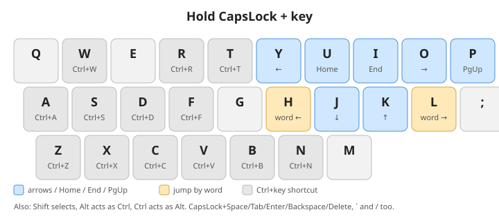

# My Enhanced Keyboard

A small AutoHotkey script that fixes the most annoying parts of a standard keyboard: arrows are too far away, `Backspace` is too far away, and `CapsLock` is useless.
Hold `CapsLock` and your home row becomes a navigation layer. Regular keys keep working as usual, so a guest at your computer won't get confused.

Inspired by [this article](https://optozorax.github.io/p/my-keyboard-layout/) and the [klavarog/enhanced-keyboard](https://github.com/klavarog/enhanced-keyboard) project.

**Version: 2.0.0** (v1 was a prebuilt `EnhancedKeyboard.exe` + registry hack, this version is a single script)

## Install

1. Install [AutoHotkey **v1.1**](https://www.autohotkey.com/) (the script is not compatible with v2).
2. Download `hjkl.ahk` and double-click it.
3. To start it with Windows: press `Win+R`, type `shell:startup`, and put a shortcut to `hjkl.ahk` into that folder.

No registry changes are needed, the script turns off `CapsLock` itself.

## What it does

Everything below is while holding `CapsLock`.

| Key | Result |
| --- | --- |
| `k` / `j` | Up / Down |
| `h` / `l` | Jump one word left / right (`Ctrl+←` / `Ctrl+→`) |
| `y` / `o` | Left / Right |
| `u` / `i` | Home / End |
| `p` | Page Up |
| `w r c v x z a s f d b t n` | `Ctrl` + the same key |
| `Space` `Tab` `Enter` `Backspace` `Delete` `/` `` ` `` | `Ctrl` + the same key |

Modifiers work on top of the arrow keys (e.g. `Shift` selects text). Note that **`Alt` and `Ctrl` are swapped**: `CapsLock+Alt+k` sends `Ctrl+↑`, `CapsLock+Ctrl+k` sends `Alt+↑`.

### Backspace with a number
Hold a digit `1`-`9` (or `0` for 10) and press `Backspace` to delete that many characters at once. The digit itself is deleted too, so exactly N characters are removed.

### Left Alt
- Tap `Alt` alone: sends `Win+Space` (switch input language).
- `Alt` no longer focuses the app menu bar when tapped.

## Notes

- There is no `PageDown` on the layer yet, only `PageUp` (`p`).
- I mostly write this for my future self, so I can restore my keyboard setup on a new computer without redoing the research. Maybe it helps someone else too ;)
